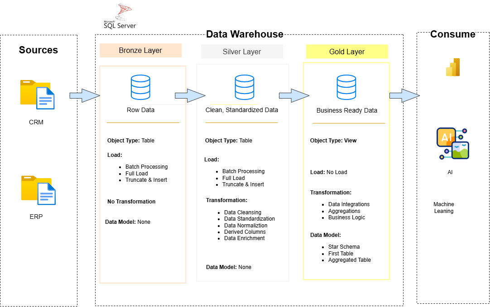

# Data Warehouse & Analytics Project

Hi, Welcome to the **Data Warehouse and Analytics Project** repository!

## Data Architechture
The data architechture of this project follows Medallion Architechture **Bronze**, **Silver** and **Gold** layers:

1. **Bronze Layer**: Stores row data as-is from the source systems. Data is ingested from CSV files into SQL Server database.
2. **Silver Layer**: This layer   includes data cleansing, standardzation and normalization processes to prepair data for analysis.
3. **Gold Layer**: Houses business-ready modeled into a star schema required for reporting and analysis.

## Project Requirements
### Building the Data Warehouse (Data Enineering)
#### Develop a modern data warehouse using SQL Server to consolidate sales data, enabling analytical reporting and informed decision-making.

#### Specifications
- **Data Sources**: Import data from two source systems (ERP and CRM) provided as CSV files.
- **Data Quality**: Cleanse and resolve data quality issues prior to analysis.
- **Integration**: Combine both sources into a single, user-friendly data model designed for analytical queries.
- **Scope**: Focus on the latest dataset only; historization of data is not required.
- **Documentation**: Provide clear documentation of the data model to support both business stakeholders and analytics teams.

---

### BI: Analytics & Reporting (Data Analysis)

#### Objective
Develop SQL-based analytics to deliver detailed insights into:
- **Customer Behavior**
- **Product Performance**
- **Sales Trends**

These insights empower stakeholders with key business metrics, enabling strategic decision-making.  
